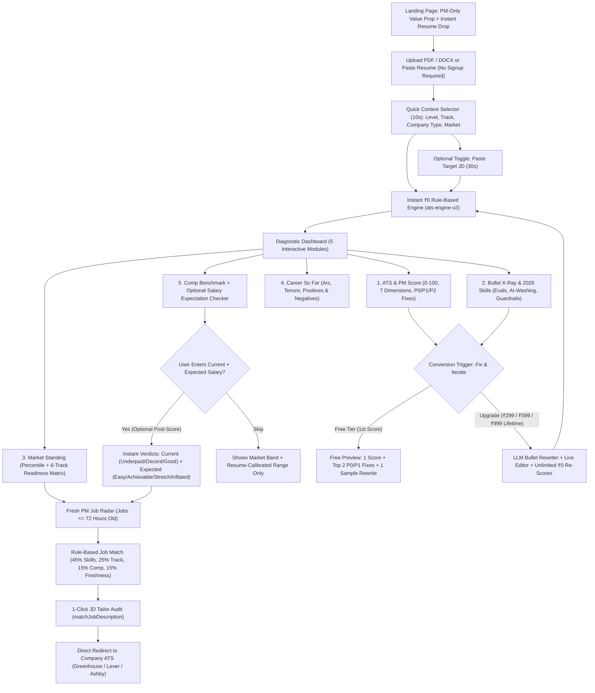
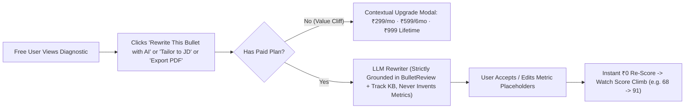

# ProductRez — End-to-End User Journey & Platform Flow

> [!IMPORTANT]
> **Core Design Principle:** Deliver the **Aha! moment in under 30 seconds** using the **₹0 deterministic rule-based engine** before asking for sensitive data (salary) or triggering a paywall. Monetize on **action & iteration** (LLM rewrites, unlimited re-scores, JD tailoring, and fresh job radar), never on hiding basic utility.

---

## 1. End-to-End Platform Flow

---

## 2. Stage-by-Stage Breakdown & UX Decisions

### Stage 1: Zero-Friction Entry (`0s – 15s`)
* **Goal:** Eliminate signup drop-off (>60% drop-off occurs when users hit an auth wall or long form first).
* **Experience:**
  * Hero section features an **un-gated Drag-and-Drop Resume Zone** (*"Drop your PM resume for an instant 2026 ATS & Market Check — no signup required"*).
  * Client-side PDF/DOCX text extraction runs in-browser so raw resume text is parsed immediately, capturing `pageCount` and `fileSizeBytes` (for Greenhouse 2.5 MB checks).
* **Guardrail:** `checkResume()` runs immediately to reject non-resumes or scanned image PDFs with a clear recovery tip (*"This looks like a scanned image PDF — export as text PDF from Google Docs/Word"*).

---

### Stage 2: Smart Calibration (`15s – 30s`)
* **Goal:** Collect only the context that **genuinely changes scoring weights and benchmarks** — nothing else.
* **What we collect (4 fast pills/chips, pre-defaulted for speed):**
  1. **Target PM Level:** `Auto-detect` | `APM` | `PM` | `Senior PM` | `Lead / Group PM`
  2. **PM Track:** `Generalist` | `AI / ML` | `Growth / PLG` | `B2B SaaS` | `Platform / API` | `Fintech`
  3. **Target Company Type:** `Early Startup` | `Scale-up` | `MAANG / Big Tech` | `Enterprise`
  4. **Market:** `India` | `United States` | `Remote Global`
  5. *(Optional collapsible accordion)* **Paste Target JD** for exact keyword & YOE gap audit.
* **What we explicitly DO NOT ask here:**
  * Current Salary or Expected Salary (creates distrust before value is shown).
  * Gender, age, graduation year, or visa status (excluded by `EXCLUDED_INPUTS`).

---

### Stage 3: The Instant Diagnostic Dashboard (`30s+`)
Runs 100% deterministically in **< 50ms at ₹0 marginal cost**. Organized into **5 high-signal modules**:

| Module | What the User Sees | Why It Drives Engagement |
| :--- | :--- | :--- |
| **1. ATS & PM Score** | `0–100` gauge, Grade (`Prototype` → `Ready to Ship`), 7 weighted dimensions, prioritized `P0/P1/P2` fix list with exact `+pts` gain. | Gives immediate clarity on *why* they are getting ghosted vs. shortlisted. |
| **2. Bullet X-Ray & 2026 Radar** | Every bullet graded `0–3` impact; flags `"AI-washing"`, missing CSAT/accuracy guardrails, repeated verbs, and 2026 skills (`AI Evals`, `Claude Code/v0`, `Context/RAG`, `Unit Economics`, `PLG`). | Shows concrete line-level gaps instead of generic resume advice. |
| **3. Market Standing** | **Market Percentile** (e.g. `88th percentile · Top 12%`), Cohort Bar, **6-Track Readiness Matrix** (`Core 94%`, `Growth 80%`, `AI/ML 61%`), and *Next Bracket Lever*. | Answers *"Am I actually competitive, and which PM roles fit me best right now?"* |
| **4. Career So Far** | **Progression Arc** (`Founder → Product Leader`, `Ascending`, `Switcher`, `Plateau`), Tenure stats, 3–5 **Positives**, and 1–5 **Negatives / Narrative Risks** (e.g., *"Older roles have 90% metrics vs. 63% in current role"*). | Feels like a candid 1:1 session with a Staff PM mentor. |
| **5. Comp & Expectations** | **Market Band** + **Resume-Calibrated Range** shown first. Inline widget: *"Check if your expectations are right"* → optional **Current** & **Expected Salary** inputs. | Zero upfront friction; huge emotional payoff when they see `Underpaid` / `Achievable` / `Inflated`. |

---

### Stage 4: Fix, Rewrite & Re-Score Loop (Monetization & Retention)

* **Free Tier (1 Full Scan):**
  * Full 0–100 score, Market Standing, Career Positives/Negatives, Comp Band + Salary Expectation Check, and **Top 2 P0/P1 findings** + **1 sample AI bullet rewrite**.
  * **Soft Auth Gate (Email / Google Sign-in):** Triggered if they want to save their report, unlock the full bullet-by-bullet X-Ray, or use the Salary Expectation Checker & Job Radar.
* **Contextual Paywall Triggers (Never a cold pricing redirect):**
  1. Clicking **"Rewrite Bullet with AI"** (beyond 1 free sample)
  2. Running a **2nd+ Re-Score** after editing or tailoring to a new JD
  3. Clicking **"1-Click Tailor Resume for This Job"** inside the Fresh Job Radar
  4. **Exporting** the ATS-clean 1-column PDF/DOCX.
* **Pricing Fit:** Because scoring + career/market/comp + job matching all cost **₹0**, your **₹999 Lifetime** plan remains highly profitable even for power users who re-score 50 times; LLM tokens are only spent on explicit paid rewrite clicks.

---

### Stage 5: Fresh PM Job Radar (`<= 72 Hours Old`)
Turns ProductRez from a **one-time resume tool** into a **weekly/daily habit** (retention engine):

1. **Automated Sync (Every 6h via GitHub Actions / Supabase):**
   * Pulls public JSON feeds from `tracked_companies` (`Greenhouse`, `Lever`, `Ashby`) + Remote feeds.
   * Classifies each job deterministically using `ats-engine-v2` (`level`, `track`, `market`, `archetype`, `extracted_skills[]`, `salary_band`).
   * Enforces strict freshness: `COALESCE(source_published_at, first_seen_at) >= now() - interval '3 days'` and `is_active = true`.
2. **Personalized Matching (`get_matched_jobs` RPC):**
   * Filters by user's `market` (or `remote_global`) and `level`.
   * Ranks `0–100` using: **45% Skill Overlap + 25% Track/Archetype + 15% Salary Fit + 15% Freshness (`< 24h` boost)**.
3. **Apply Workflow:**
   * User sees fresh matching jobs with **Match %**, **Missing Skills**, and **Posted X hours ago** badge.
   * **Free users:** See top 3 matching jobs (with company/role) + can click *"Run JD Match Check"* on 1 job.
   * **Paid users:** Full daily feed, **1-Click JD Tailor Audit** (`matchJobDescription()`) before applying, and direct redirect to the company's official ATS application URL (`apply_url`).

---

## 3. UI Screen Inventory (Next Phase: Front-End Redesign)

When we move to UI design, this user journey maps cleanly to **5 core screens**:

1. **Landing & Instant Drop (`/`)** — PM-only positioning, un-gated resume dropzone, live interactive demo preview, social proof, and transparent ₹299 / ₹599 / ₹999 pricing.
2. **Calibration Modal / Stepper** — 10-second 4-pill context selector + optional JD paste.
3. **Career & Resume Command Center (`/dashboard` / `/report/:id`)** — Tabbed or bento layout with:
   * *Overview & Score* (0–100 gauge, 7 dimensions, P0/P1/P2 action list)
   * *Bullet X-Ray & 2026 Skills* (line-by-line audit + inline LLM rewrite trigger)
   * *Market & Career* (Percentile, 6-Track Readiness Matrix, Career Arc, Positives & Negatives)
   * *Compensation Check* (Market Band, Calibrated Range, interactive Current vs. Expected Salary widget)
4. **Live Resume Editor & Re-Scorer (`/editor/:id`)** — Split-screen ATS-safe single-column editor on the left + live ₹0 score delta & AI rewrite assistant on the right.
5. **Fresh PM Job Radar (`/jobs`)** — `< 72h` curated PM jobs ranked by relevance, showing match %, skill gaps, comp fit, *"Tailor Resume for This JD"* CTA, and direct ATS apply link.
